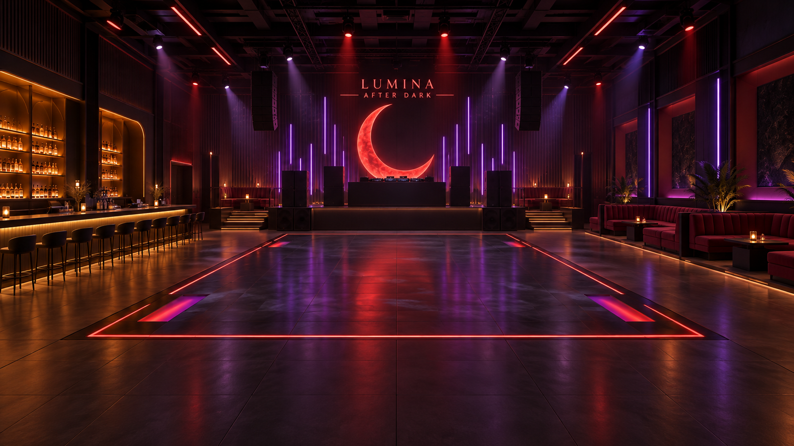
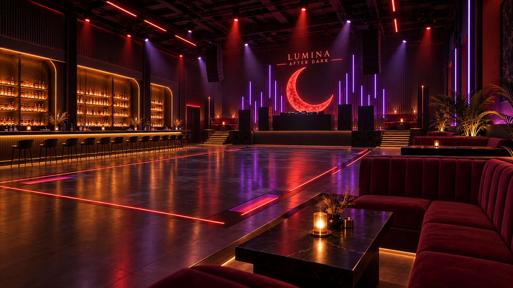

# Lumina After Dark handoff

Read the repository `AGENTS.md`, then:

- [Build plan](BUILD_PLAN.md): design and nine construction stages.
- [Bridge runbook](BRIDGE_RUNBOOK.md): commands, preflight, and practical limits.
- [Build state](BUILD_STATE.json): current stage, placement anchor, and durable IDs.
- [Build log](BUILD_LOG.md): decisions, verification, and unfinished work.
- [Starter prompt](START_A_NEW_CHAT.md): copy into a future chat.

Approved concept references, recovered from the original design conversation:

The current nightclub status is **planned, not constructed**. The live test Space
contains previous experiments, which are not nightclub progress.

These files were prepared on October 30, 2026 from `Inspect Project Lumina setup`
(thread `01a18954-b79b-7251-8474-8a776b5624f5`). Exact design dimensions and stage
sequence were recovered from that conversation. Construction coordinates below
are explicitly proposed, not previously approved dimensions for every object.

The root `AGENTS.md` is the repository instruction entry point. This follows
[OpenAI's repository-guidance convention](https://developers.openai.com/cookbook/examples/codex/iterating-development-workflows-with-codex).
